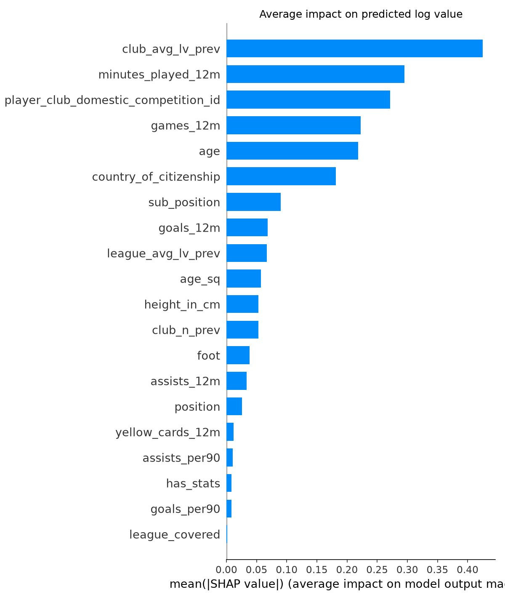
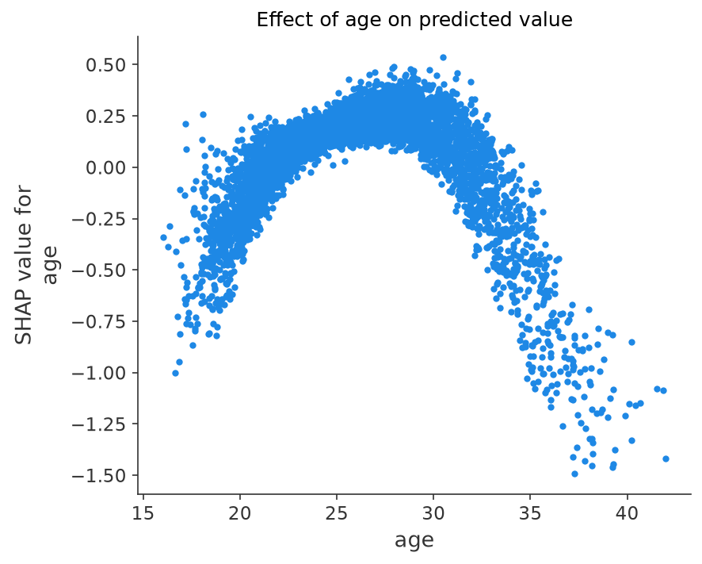

# Footballer Market Value Prediction

Predicting Transfermarkt market values of professional footballers with machine learning (Python, scikit-learn, XGBoost, LightGBM, SHAP).

## Data
Download the "Football Data from Transfermarkt" dataset from Kaggle (davidcariboo/player-scores)
and place the CSVs in `data/raw/`. Check the dataset page for its license and credit the author.

## Setup
    python -m venv venv
    venv\Scripts\activate
    pip install -r requirements.txt

## Approach
- **Data:** about 554K Transfermarkt valuations (July 2013 to June 2026), joined with player attributes and 12-month performance stats built only from games *before* each valuation date.
- **Target:** log of market value, because raw values are heavily right-skewed.
- **Validation:** split by time (train up to 2023, validate on 2024, test on 2025 to June 2026), so the model is always judged on the future.
- **Features:** age, position, height, citizenship, goals/assists/minutes over the previous 12 months, and club and league context computed from other players' earlier valuations (the player's own history is excluded).

## Results
Held-out test set (2025 onward), scored once after all model choices were made on validation data:

| Model | R² (log) | Median % error |
|---|---|---|
| Ridge (baseline) | 0.683 | 52.9% |
| **LightGBM** | **0.770** | **42.1%** |
| LightGBM, leagues with performance data | 0.848 | 38.5% |
| LightGBM, other leagues | 0.568 | 44.6% |

On validation, XGBoost (R² 0.763) and LightGBM (0.767) beat Ridge (0.662), and LightGBM was tuned and selected.

## What drives the predictions

Club context, minutes played and league matter most. Value peaks around 27 to 29 and drops steeply after about 32.

## Error analysis
- The model compresses extremes: players worth over 1M are underpredicted on average, and the cheapest players are overpredicted.
- It underpredicts players under 20 (it cannot see potential) and overpredicts players over 32.
- The worst misses are young players valued on potential, players with no recorded minutes, and a few high-minute players at big clubs valued low.

## Limitations
- The model has no access to potential, reputation or injury status, so the typical error is still around 40%.
- Performance data only covers about 14 leagues. For other leagues the stats are treated as unknown.
- The league label in the source data is one fixed value per club, so older rows may carry a club's current league and not its league at the time. I tested dropping the league features and adding a club-tracking signal; neither beat the final model on validation.

## Project structure
`notebooks/01` cleaning, `02` feature engineering, `03` modeling, `04` explainability and error analysis. Final model in `models/`, test metrics in `reports/`.